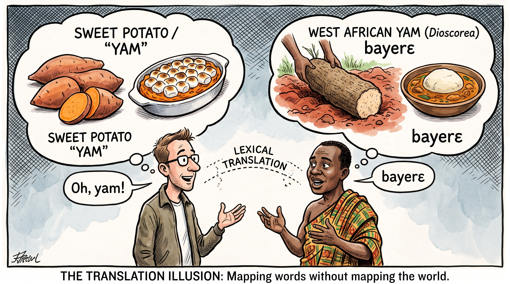

# AfriVL-Bench

A multimodal benchmark evaluating culturally and regionally grounded visual
vocabulary across 9 African languages.

<p align="center">
  
</p>
<p align="center">
  <em><b>The Translation Illusion:</b> Direct lexical translation maps "bayerɛ" to "yam", but the underlying physical, agricultural, and cultural referents diverge completely.</em>
</p>

Each question shows an **image** of a concept and asks a model: *"In
`<language>`, which of these 4 options is the correct word for what's
pictured?"* One option is the real human-curated translation; the other three
are real human translations of *other* concepts in the same language, so every
wrong answer is still a plausible-looking word rather than invented text.

```
[image of a banana] + "In Hausa, which word means this?"
  A. ayaba      <- correct
  B. kujera
  C. mota
  D. rigar
```

This tests whether a vision-language model can ground a word in an image, not
just translate text — a model that only pattern-matches text could not answer
these questions without actually looking at the picture.

## Data

* **Concepts & reference translations** — [`data/bu200.json`](data/bu200.json),
  carried over from the
  [BU 200 Word Project](https://www.bu.edu/200word/) scrape built for
  [gemini-word-mt-bench](https://github.com/AfriSpeech/gemini-word-mt-bench),
  with human-curated reference translations into up to 9 languages (isiXhosa,
  isiZulu, Amharic, Wolof, Hausa, kiSwahili, Igbo, Akan Twi, Mandinka). Scope
  is restricted to **concrete nouns** — real, photographable objects — so
  three categories are excluded entirely: "days of the week" (no photo
  represents "Monday"), and "numbers" and "colors" (a digit or a swatch tests
  symbol/attribute recognition, not whether the model can name a pictured
  thing). The remaining 13 categories (animals, body parts, clothing, cooking,
  farm, food and drink, house, natural world, people, places, professions,
  school, transportation) are all genuinely picturable objects.
* **Images** — `scripts/00_fetch_images.py` sources one image per concept from
  Wikimedia Commons (the only source used — general web image search mostly
  surfaces paid stock photos with no redistribution rights). Wikipedia's own
  "canonical" photo for a word is reliably a generic/Western stock image blind
  to where these languages are spoken, so instead of Wikipedia's summary API
  this searches Commons directly, cycling the word with each of the 8
  countries the 9 reference languages are actually spoken in — Ghana, Nigeria,
  South Africa, Kenya, Ethiopia, Senegal, Tanzania, Gambia (from
  [afriso](https://github.com/AfriSpeech/afriso)) — e.g. `"pepper nigeria"`
  finds an actual Nigerian market instead of a seed-catalog illustration.
  "body parts" is the one exception: anatomy doesn't vary by country, and a
  country-qualified query actively hurt it (`"chin south africa"` matched a
  war-memorial statue), so that category searches the bare English word first.

  Every candidate photo — not just the first hit — is shown to Gemini (vision)
  with the question "does this actually, unambiguously depict the word?"
  before being accepted; a rejected candidate is discarded and the next one
  from the search results is tried, up to 12 candidates per word, so a bad
  keyword match (a brand name, a place name, the wrong sense of the word)
  gets caught and retried automatically rather than trusted on sight.
  `data/search_hints.json` overrides the query — or pins an exact
  `"File:..."` — for words a plain search can't resolve. Every image's
  verdict and reasoning is recorded in `data/images_manifest.json`
  (`"gemini_verified"`, `"gemini_note"`); a word that doesn't pass for any of
  its 12 candidates is simply excluded from the question set rather than
  shipped with a bad image — 13 of the 218 concrete-noun concepts (mostly
  relational/profession terms — Doctor, Father, Brother, Sibling, Goldsmith —
  that are inherently hard to photograph unambiguously) didn't clear the bar.
* **Questions** — `scripts/01_build_questions.py` builds a 4-way
  multiple-choice question for every (concept, language) pair that has both a
  verified image and a human reference translation, with 3 distractors
  sampled from other concepts' real translations into the same language.

## Pipeline

```bash
cd scripts
export GEMINI_API_KEY=...
python3 00_fetch_images.py     # → data/images/, data/images_manifest.json (search + verify, see above)
python3 01_build_questions.py  # → data/questions.json
python3 02_bench_gemini.py --models gemini-2.5-flash,gemini-2.5-pro
python3 03_aggregate.py        # → results/summary.json
```

`00_fetch_images.py` is idempotent — re-run with `--refresh` to redo words
already verified against a stricter/changed prompt, or plain to pick up only
words that still lack one (e.g. after adding a `search_hints.json` entry).

`02_bench_gemini.py` is resumable per model — it appends to
`results/<model>.jsonl` and skips question ids already answered.

```bash
python3 04_aggregate_human_eval.py   # pulls human-eval/ submissions → merges into results/summary.json
```

## Current dataset size

**205** of **218** concrete-noun concepts have a verified image (13 excluded
for lacking one — see above) → **1,207** questions across the 9 reference
languages:

| language | questions |
|---|---|
| Igbo | 156 |
| isiXhosa / isiZulu | 143 each |
| Hausa | 137 |
| kiSwahili | 134 |
| Wolof | 127 |
| Amharic / Mandinka | 123 each |
| Akan Twi | 121 |

## Results

First full run, all 1,207 questions, two Gemini generations:

| model | overall pass rate |
|---|---|
| gemini-3.6-flash | **94.8%** |
| gemini-2.5-flash | **90.3%** |

gemini-3.6-flash beats gemini-2.5-flash on **every single category** — a
clean generational improvement, not noise. Hardest categories for both models
are school, professions, clothing and farm (85–92%); easiest are food and
drink, animals and transportation (96–99%), against a 25% chance baseline.
Full per-language/per-category breakdown is in
[`results/summary.json`](results/summary.json) and the
[dashboard](https://huggingface.co/spaces/AfriSpeech/afrivl-bench).

## Models

Currently benchmarked via the Gemini API only (`google-genai` SDK,
`GEMINI_API_KEY` env var). Local/open-weight vision-language models may be
added later as a second runner.

## Dashboard

A static HTML/JS page in [`space/`](space/), deployed as a static Hugging Face
Space at [`AfriSpeech/afrivl-bench`](https://huggingface.co/spaces/AfriSpeech/afrivl-bench),
reads `results/summary.json` from this repo at page load — the same pattern as
[gemini-afro-mt-bench](https://github.com/AfriSpeech/gemini-afro-mt-bench).

## Human ground truth review

A second static page, [`human-eval/`](human-eval/) (deployed to Hugging Face Spaces at
[`AfriSpeech/afrivl-bench-human-eval`](https://huggingface.co/spaces/AfriSpeech/afrivl-bench-human-eval)),
allows reviewers to establish visual-linguistic ground truth across 9 African languages.

Reviewers select their language, view the authentic local word alongside country-grounded
candidate photos from Wikimedia Commons (one at a time), and evaluate whether each image matches:
- **Yes ✓**: Confirms that this image accurately depicts the local word in that country/culture context.
- **No ✕**: Cycles to the next candidate photo. If all candidates are exhausted with "No", the concept is flagged as lacking a verified image and saved for sourcing.
- **Skip**: Moves to the next word.

Submissions are saved client-side directly to the dataset:
[`AfriSpeech/afrivl-bench-human-eval`](https://huggingface.co/datasets/AfriSpeech/afrivl-bench-human-eval)
via a write-only, dataset-scoped Hugging Face token.

### Symmetrical sequential LLM benchmarking

`scripts/04_build_ground_truth_from_human_eval.py` aggregates human selections into
`data/questions_ground_truth.json`. To maintain strict experimental fairness, the model
is evaluated under the exact decision horizon experienced by the human reviewer:

- **1st image accepted:** If the native reviewer approved the very first candidate photo, the human made a binary decision on that image alone. The LLM is given that single image and prompted to decide `Yes` or `No` (ground truth: `Yes`).
- **k-th image accepted (k > 1):** If the reviewer rejected images `1 .. k-1` before accepting candidate `k`, the model is given the exact `k` images seen up to that point (labeled A, B, ..., shuffled) to identify which one depicts the local word. Candidates beyond `k` were never judged by the human and are strictly excluded.

Model pass rates are computed directly against native speaker consensus.

## Caveats

* The multiple-choice format means a model can get partial credit from
  elimination/guessing; chance baseline is 25% (4 options).
* Distractors are drawn from the *same* language's other concepts, so a model
  that recognizes "this is a body-part word in Hausa" without knowing which
  body part could still do better than chance on categories where concepts
  within a category share obvious lexical patterns. Category-level pass rates
  should be read against the 25% baseline, not against 0%.
* Reference translations exist for only 9 languages (the ones the BU 200 Word
  Project itself published), so this benchmark's language coverage is far
  smaller than the word-level round-trip benchmark's 1,622 languages — it is
  a different, narrower measurement (visual grounding) on a fixed set of
  "anchor" languages with a human-verified answer key.
